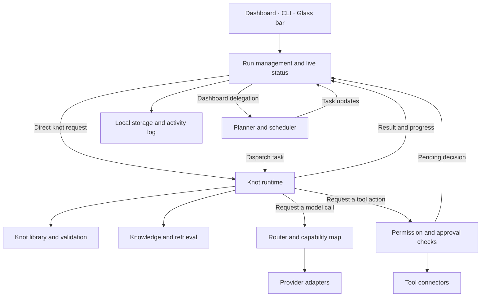
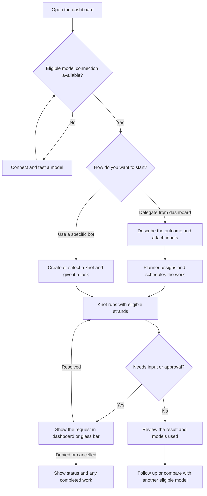
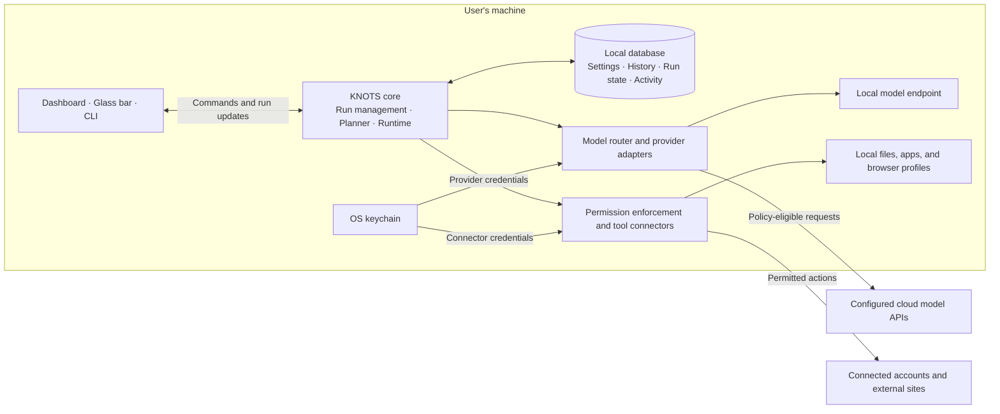

# KNOTS components, user journey, and architecture

Based on [KNOTS-Project-Plan.md](KNOTS-Project-Plan.md) and its phase order. The diagrams describe the planned product. Phase 1 scope is marked separately.

## 1. Understand the components

| Component | What it does | Example |
|---|---|---|
| Dashboard, CLI, and glass bar | Let the user configure KNOTS, submit tasks, and see results. The dashboard and overlay can also show and steer live work in Phase 2. | Start a review in the dashboard and check progress from the hotkey overlay. |
| Knot spec and library | Define and store reusable bots. Validate the definition and its referenced files. | Save a Contract Reviewer with review instructions and a company policy. |
| Planner and scheduler | Decide which knots should handle a dashboard request, break work into tasks, and decide what runs when. | Assign the agreement review to Contract Reviewer and queue it behind a higher-priority task. |
| Knot runtime | Run a selected knot. Assemble context, request model calls, handle permitted tools, and return the result. | Load the reviewer instructions, relevant policy excerpts, and the agreement. |
| Router and capability map | Choose an eligible strand for each model call using the task or lane, model capabilities, privacy rules, budgets, and configured preferences. | Select a model that supports the input and use a local strand when the task requires it. |
| Provider adapters and strands | Send normalized requests to connected local or cloud models and return responses and usage when available. | Call Ollama locally or a configured cloud endpoint. |
| Knowledge and retrieval | Index and retrieve reference material when it is needed for a task. | Find the company policy sections relevant to the clauses under review. |
| Tools and permissions | Decide whether a requested action can run, wait for approval if required, and execute through the appropriate connector. | Read an authorized file or pause before sending a review by email. |
| Local storage and keychain | Keep bot definitions, settings, history, and activity locally. Store provider credentials and OAuth tokens in the OS keychain. | Reopen a review after relaunching the app without putting credentials in the knot. |

The distinction between three components matters most. **The planner chooses the bot and schedules the work. The runtime runs the bot. The router chooses the model for a call.** A direct request to a named knot already supplies the planner's bot choice.

## 2. Component diagram

This is a logical map. The arrows show which component uses another or sends work to it.

## 3. User journey

A returning user can address a saved knot directly. In Phase 3, importing a knot becomes another way to add one to the library. If execution fails, KNOTS shows the blocking issue and preserves the draft when the user can fix it.

## 4. System architecture and boundaries

- **One run state.** The core owns lifecycle state, cancellation, and pending approvals. Dashboard and glass bar read the same state and send commands to the same run. CopilotKit and AG-UI are Phase 2 references for communicating those updates.
- **Check each model call.** The router accounts for the actual input and capabilities needed for that step. If a call is local-only, a cloud fallback is ineligible. If no strand qualifies, the core reports why.
- **Check each tool action.** The permission layer checks the applicable profile, action, and approval before the connector runs it. The runtime surfaces pending decisions through the same run state.
- **Keep credentials with the connection.** Provider adapters and authorized connectors use the OS keychain. An exported knot carries its definition and declared requirements, and the receiving setup supplies credentials.
- **Process boundaries remain open.** The arrows describe responsibilities. Whether the core is in-process or a local service, and how the desktop UI and CLI attach to it, are Phase 1 design decisions.

## 5. What belongs in each build

| Phase | Architecture demonstrated |
|---|---|
| **1 · MVP** | Dashboard, CLI, and a prototype glass bar use a shared runtime and versioned knot spec. Run a selected knot on configured strands, swap models, and compare responses. Record activity and verify cancellation on Windows and macOS. |
| **2 · Automated execution** | Add the planner, per-call routing and fallback, retrieval, tools and permissions, live board, and glass bar steering. One dashboard request can use more than one strand and return one result. |
| **3 · Portability and expansion** | Add local import/export, scored evaluation, registry and plugins, expanded Linux support, and optional hosted capabilities. |
