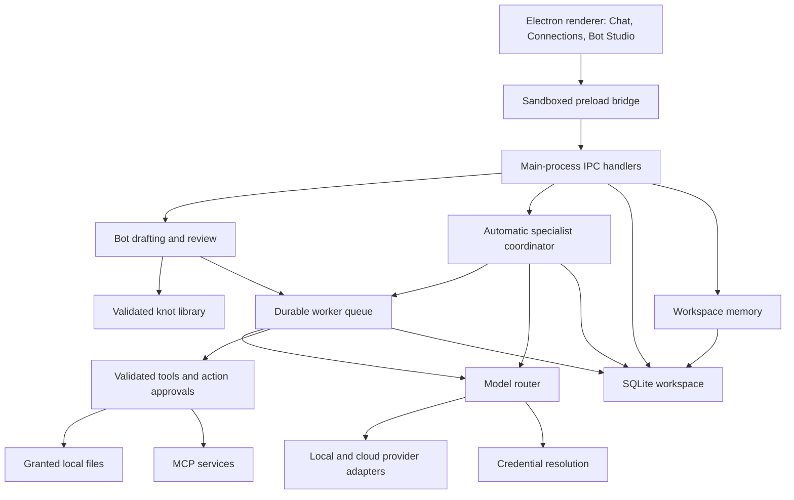

# Understanding KNOTS

A guide for someone encountering the project for the first time.

Last reviewed: 26 November 2026. This describes main after the ALT integration and the first automatic-bot-creation milestone. Later improvement milestones are explicitly marked as planned.

## 1. The project in one paragraph

**KNOTS is a local-first desktop application for creating reusable AI bots, connecting them to different language models, and giving them tasks they can execute using permitted tools.** A bot defines what work to do and how to approach it; a model connection supplies the intelligence for each call. Users can either send a task directly and let KNOTS assemble temporary specialists, or describe a recurring problem and review a reusable bot created for it. The longer-term goal is for bots to become more useful through corrections, tested proposals and reviewed updates.

The tagline is **“Bind any model to any bot.”** In practice, “any” means a compatible model reachable through a supported adapter, subject to the bot's requirements and data policy.

## 2. The problem it addresses

People repeatedly describe the same role, format, context and preferences to AI tools. Their workflows become tied to one provider, while actions on local files or connected services need more control than a chat answer provides.

KNOTS separates:

- The reusable definition of the work.
- The model connection used to reason about it.
- The tools and access required to act.
- The execution record, approvals and results.

A reporting bot can retain its purpose when a user changes models. A task can use different eligible models at different stages. A proposed file write remains a reviewed action rather than an assertion in a chat response.

## 3. Vocabulary

| Term                 | Meaning                                                                                                                       |
| -------------------- | ----------------------------------------------------------------------------------------------------------------------------- |
| Knot / bot           | A saved definition containing instructions, purpose, expected output and optional tools/model policies.                       |
| Strand               | A named connection to a provider, model and optional endpoint, with credential references and routing settings.               |
| Lane                 | An ordered preference for model connections at a stage of work.                                                               |
| Run                  | One execution with input, status, output, model receipts and possible actions.                                                |
| Worker job           | A durable queued execution with a checkpoint and lifecycle controls.                                                          |
| Conversation         | A persisted series of user tasks and completed responses.                                                                     |
| Automatic specialist | A generated task-specific agent used for the current request; it is not automatically a saved library bot.                    |
| Plan                 | A collection of bot tasks. Reviewed plans have explicit dependencies; automatic chat currently creates parallel specialists.  |
| Grant                | User-selected folder access for execution. A saved filesystem path alone is not a grant.                                      |
| Approval             | A decision allowing a particular proposed file or MCP action.                                                                 |
| Memory               | A local, retrievable entry derived from a conversation or saved explicitly. Memory can be wrong and is not proof of learning. |
| Teaching proposal    | A proposed instruction change based on a corrected run, with review and revert support.                                       |

## 4. Who can use it, and for what?

The current app is suitable for people experimenting with repeatable text work, analysis of authorized text files, drafting reports and model-independent bots. Developers can also connect supported MCP services.

Examples include a release-note writer, a folder-audit report bot, a writing assistant or a reviewer working from supplied text. These are examples of roles, not hardcoded product categories.

The earlier PDF-organizer idea illustrates the ambition of autonomous local work. The current built-in tools do not parse PDFs, move files, delete files or reorganize a laptop. That use case requires additional tools and action semantics.

## 5. Current user journey: first-time setup

1. Install development dependencies and start the Electron application, or use a separately verified desktop build.
2. Open **Connections**.
3. Add a named strand with provider, model, endpoint where applicable, and credentials if required.
4. Test the connection. A configured connection is not proof the provider is reachable or the model is installed.
5. Choose light or dark mode. The preference is saved locally and shared between the chat and Bot Studio pages.
6. Start a chat, or open **Bot Studio** to create a reusable bot.

Using cloud models sends eligible task content to that provider and can incur charges. Local-first describes where workspace state lives; it does not mean every computation is offline.

## 6. Current user journey: send a task directly

1. Start a new chat and describe the task.
2. Optionally select a model override and grant input/output folders.
3. KNOTS asks a model to propose one specialist for a simple request or several specialists for a complex request, up to twelve.
4. A simple text-only request can execute directly. Other requests enqueue specialist jobs through the worker.
5. File creation requires review of the exact destination and contents before execution.
6. When specialists finish successfully, KNOTS returns their answer directly or synthesizes a combined response.
7. The conversation is retained. A compact excerpt of a nontrivial completed exchange can be captured in workspace memory and retrieved in later chats.
8. The user can rename or delete the chat. **Deleting a chat retains its captured workspace memory**; use Bot Studio → Memory to forget entries separately.

The automatic specialists are temporary task definitions stored with the execution. They do not automatically become reusable knots.

### Important automatic-chat limitation

Child jobs use the durable worker. The parent provisioning/waiting/synthesis function is currently an in-memory coordinator, not a fully checkpointed workflow. Do not assume an interrupted automatic team can resume end to end after application restart. The first integration fixes prevent failed children from being silently reported as a successful automatic plan, but complete coordinator recovery remains work to do.

## 7. Current user journey: create a reusable bot from a problem

1. Open **Bot Studio → Create** and describe a problem.
2. Choose local-only processing or allow cloud processing. Save the problem locally; a model is not needed merely to retain the draft.
3. KNOTS suggests potentially relevant saved bots using simple text matching and explains the matching terms. The user decides whether to reuse one.
4. Choose **Generate / refine draft** when a suitable model is connected.
5. Review the proposed name, purpose, instructions, output, success criteria, assumptions, essential questions and capability gaps.
6. Supply clarification and regenerate, or edit the draft. Unsupported tools must remain visible as gaps rather than being promised as available.
7. Resolve questions and gaps before activation. Keeping an unfinished edited draft is allowed.
8. Choose **Save reusable bot**. Saving creates no folder grant or action approval.
9. Grant required input/output access and choose **Run original task**.
10. The task enters the normal worker and the result opens in chat. Repeated activation requests reuse the same first-run identity instead of enqueueing duplicate work.

The creation review currently supports built-in text-file requirements. MCP allowlists and advanced policies are not generated automatically. The validated definition deliberately excludes hidden generated credentials, endpoints, routing rules and grants.

Saved bots can be suggested for another problem. The old manual Knots, Plans and Activity screens removed by ALT remain removed; Bot Studio provides the new creation entry point. Some older backend capabilities listed below do not yet have replacement controls in the simplified frontend.

## 8. Feature inventory and availability

| Feature                              | Current implementation / access                                                                                                                                                                            |
| ------------------------------------ | ---------------------------------------------------------------------------------------------------------------------------------------------------------------------------------------------------------- |
| Automatic chat specialists           | Available in Chat; generated roles, parallel child jobs and result synthesis.                                                                                                                              |
| Reusable bot creation from a problem | Available in Bot Studio; persisted draft, review, reuse suggestion and first run.                                                                                                                          |
| Light and dark appearance            | Available across Chat, Connections and Bot Studio; saved locally.                                                                                                                                          |
| Connections and model routing        | Available; supported adapters, explicit pins, inspect/deliver routing and receipts.                                                                                                                        |
| Local file actions                   | Granted text-file list/read; reviewed create-only output. No overwrite, move, delete or shell.                                                                                                             |
| Durable execution                    | Worker queue, checkpoints, pause/resume, questions and explicit restart recovery for worker jobs. Parent automatic coordination has the limitation above.                                                  |
| Cross-chat memory                    | Automatic compact exchange capture, relevance retrieval and privacy filtering. Inspect/forget in Bot Studio.                                                                                               |
| Portable context                     | Deterministic clipping/compaction to fit configured windows; older details can be lost.                                                                                                                    |
| Peer messages                        | Persisted plan message board with size/count limits; receiving bots retain local-only restrictions.                                                                                                        |
| MCP                                  | Connection configuration in Connections; core allowlists, schema validation and approval per call. Automatic specialist creation currently provisions built-in file tools, not arbitrary MCP integrations. |
| Reviewed dependency plans            | Implemented backend, validation and scheduler; legacy Plans screen removed. Automatic chat uses parallel tasks without a dependency DAG.                                                                   |
| Local knowledge references           | Implemented backend for bounded UTF-8 attachments and lexical retrieval; old management UI removed.                                                                                                        |
| Portable bot import/export           | Implemented backend for reviewed JSON packages; old management UI removed. Packages do not include credentials or grants.                                                                                  |
| Teach this knot                      | Existing backend and tests support corrections, text comparisons, accept/revert; legacy teaching UI removed. A new improvement inbox is still planned.                                                     |
| Quick bar                            | Existing global shortcut/tray entry backed by the same desktop runtime.                                                                                                                                    |
| General computer control             | Not implemented. No arbitrary shell, browser automation or full filesystem access.                                                                                                                         |
| Automatic verified self-improvement  | Planned; memory capture alone does not provide it.                                                                                                                                                         |

## 9. How model selection works

A bot does not embed a provider-specific model. It carries instructions and optional preferences, policies and lane names. A strand supplies a provider/model connection.

For desktop worker calls, the router:

1. Determines the inspect or deliver stage and ordered candidate connections.
2. Checks local-only privacy, provider/model rules, capability requirements, configured context and budget constraints.
3. Selects an eligible connection and records the reason.
4. Preserves task observations across model changes, compacting text where necessary.
5. On supported provider failures, tries an eligible fallback for the failed model call. It does not automatically repeat a verified tool action.

An explicit model override remains subject to eligibility rules. KNOTS does not currently benchmark all connected models or guarantee optimal selection. Automatic team tasks also lack a unified plan-wide spending cap and aggregate parent cost view; per-run receipts are the reliable evidence.

## 10. Tools, permissions and background work

The model proposes tool actions. The runtime validates and executes them. A prompt cannot grant itself access.

- Built-in file tools handle text up to 64 KB within granted directories.
- File output is create-only, uses exclusive creation and is read back for hash verification.
- MCP supports named Streamable HTTP servers, explicit per-bot allowlists and approval before each call. Local-only restrictions also constrain remote tools.
- Pending decisions and action outcomes are persisted.
- An uncertain external effect requires reconciliation, not blind retry.
- Recovered worker jobs remain held for review; native folder access must be renewed.
- Closing the window leaves the application running. Quitting or shutting down the machine stops computation. There is no hosted service continuing work while the laptop is off.
- The desktop currently has eight worker slots. Automatic parent calls occur outside that child-worker queue.

Memory is currently captured automatically for eligible task runs. It stores abbreviated exchanges, not independently checked facts. User content, model responses, retrieved text and imported bots should be treated as untrusted data.

## 11. Self-improvement: intended behavior

The planned loop is:

**Describe a problem → create/reuse a bot → run → correct or assess → propose a bounded change → evaluate → review/adopt → retain rollback.**

This improves the bot's instructions or supporting context. It does not retrain a provider model, invent new tools or silently expand access.

The existing teaching backend offers a starting point: completed-run corrections, instruction proposals, text-only before/after comparisons on the same selected model, user assessment and accept/revert with stale-edit protection.

The remaining roadmap is:

1. Reusable, versioned evaluation suites with explicit improvement versus held-out cases.
2. An opt-in improvement inbox built on teaching, with evidence and regression review.
3. Structured playbooks and verified procedures, including isolated tool fixtures rather than live side-effect replay.
4. Model auditions using the same approved cases, quality assessments, known cost and latency.

See [the full plan](BOT-CREATION-AND-IMPROVEMENT-PLAN.md) for acceptance criteria. A passing test suite supports a claim about its cases, not guaranteed future quality.

## 12. Architecture



The renderer cannot access Node.js or the filesystem directly. It calls a fixed preload API; main-process handlers enforce application checks. The core owns domain behavior and persistence. Provider adapters normalize model interactions. Tool execution is distinct from text generation.

## 13. Technology stack

| Area            | Technology                                                                                                                                                                         |
| --------------- | ---------------------------------------------------------------------------------------------------------------------------------------------------------------------------------- |
| Language/build  | TypeScript, ECMAScript modules, npm workspaces, `tsc`.                                                                                                                             |
| Desktop         | Electron 43.8.13; isolated/sandboxed renderers and IPC.                                                                                                                            |
| Frontend        | Plain HTML, CSS and JavaScript. No React dependency. Shared soft-gradient theme with local appearance preference.                                                                  |
| Persistence     | SQLite through better-sqlite3, versioned migrations and private pre-migration backups.                                                                                             |
| Bot definitions | YAML through js-yaml; JSON Schema validation through AJV.                                                                                                                          |
| Model adapters  | Ollama, OpenAI, Anthropic, Google, OpenRouter and OpenAI-compatible endpoints. Provider SDKs plus adapter-specific transport.                                                      |
| Integrations    | Official MCP client and Streamable HTTP transport.                                                                                                                                 |
| Credentials     | Optional OS keychain through keytar, encrypted-file fallback and supported provider environment variables. The fallback is not equivalent to an independent hardware-backed vault. |
| CLI             | Commander, Inquirer, Chalk and Ora.                                                                                                                                                |
| Packaging       | electron-builder, native dependency rebuilding, unsigned packaging and packaged-startup smoke tooling.                                                                             |
| Verification    | TypeScript build, JavaScript/source integrity checks and Electron integration tests with temporary fixtures.                                                                       |
| CI              | GitHub Actions verification and platform build workflows; see RELEASE.md for actually verified targets.                                                                            |

There is no required hosted application backend, account system, subscription service, embedding database or training pipeline.

## 14. Repository map

```text
packages/
  types/       Shared contracts for knots, strands, models and run records
  core/        Knot library, SQLite, routing, worker, tools, memory and teaching
  providers/   Provider/model adapters
  desktop/     Electron main process, preload bridge, renderer and runtime tests
  cli/         Terminal entry points
knots/         Bundled example bot definitions
references/    Design references
scripts/       Workspace checks and supporting tooling
.github/       CI and release workflows
```

Useful implementation entry points:

- `packages/core/src/bot-creation.ts`: persisted problem drafts and reviewed activation.
- `packages/core/src/run/auto-agents.ts`: temporary specialist provisioning and synthesis.
- `packages/core/src/run/worker.ts`: queueing, checkpoint execution and action lifecycle.
- `packages/core/src/routing/router.ts`: eligible model selection and receipts.
- `packages/core/src/memory.ts`: cross-chat entries and context compaction.
- `packages/core/src/teaching.ts`: existing corrected-run proposals and replay comparisons.
- `packages/desktop/src/main/ipc-handlers.ts`: main-process application API.
- `packages/desktop/src/renderer/dashboard/`: chat, studio and shared styling.

## 15. Local data and portability

The default workspace is `~/.knots`; override it with `KNOTS_DATA_DIR`. It contains the SQLite database, bot definitions and supporting managed assets. Library updates can retain versioned YAML backups. Run records preserve definition snapshots needed to understand prior work.

A strand stores connection metadata and a credential reference; secrets are resolved separately. Supported cloud environment variables include `OPENAI_API_KEY`, `ANTHROPIC_API_KEY`, `GEMINI_API_KEY` / `GOOGLE_API_KEY` and `OPENROUTER_API_KEY`.

Portable packages contain bot definitions and validated reference assets, not provider credentials, endpoints or access grants. A recipient must configure connections and review the bot. Do not assume all local data is encrypted: ordinary workspace content is stored locally with filesystem protections, not whole-workspace encryption.

## 16. Start developing

Use Node.js 24 LTS (minimum 22.12), npm and your platform's native build tools.

```bash
npm ci
npm run verify
npm run rebuild:native -w @knots/desktop
npm run start -w @knots/desktop
```

After relevant implementation changes:

```bash
npm run verify
npm run test:runtime -w @knots/desktop
```

The native SQLite build must match the executing runtime. Switching between regular Node and Electron may require rebuilding the native module for the appropriate runtime.

The normal runtime suite uses synthetic providers, temporary workspaces and local fixtures. It is not evidence that every live provider account works. Live-provider verification is a separate opt-in path and can incur charges. Electron tests also need an environment that permits launching a desktop process.

For unsigned packaging and release checks, follow RELEASE.md rather than treating a successful TypeScript build as a shipped release.

## 17. Current boundaries and next work

KNOTS can already connect models, generate specialist teams, create reusable reviewed bots, execute bounded tools and retain work. It still needs stronger automatic-team recovery and resource accounting, replacement controls for selected legacy backend features, reusable evaluation suites and the remaining reviewed-improvement milestones.

The project is a working desktop application under active development. Signing/notarization, live-provider accounts and native platform walkthroughs remain distinct distribution gates. Earlier release artifacts do not include new source changes until rebuilt and verified.

## 18. Which document should I read next?

- [README.md](README.md): concise project entry point and commands. Older feature walkthroughs may describe removed screens; this guide explains the current simplified frontend.
- [BOT-CREATION-AND-IMPROVEMENT-PLAN.md](BOT-CREATION-AND-IMPROVEMENT-PLAN.md): next product milestones and acceptance criteria.
- [IMPLEMENTATION.md](IMPLEMENTATION.md): historical implementation decisions and completed work.
- [NEXT-STEPS.md](NEXT-STEPS.md): research and previous roadmap notes; some entries are historical.
- [KNOTS-Architecture.md](KNOTS-Architecture.md): earlier architecture design; check source and this guide for current details.
- [RELEASE.md](RELEASE.md): release checks, evidence and remaining distribution gates.

When changing behavior, update this guide's implemented/planned distinctions and the relevant README walkthrough. Do not describe a proposed capability as available merely because its tab, type or research reference exists.
